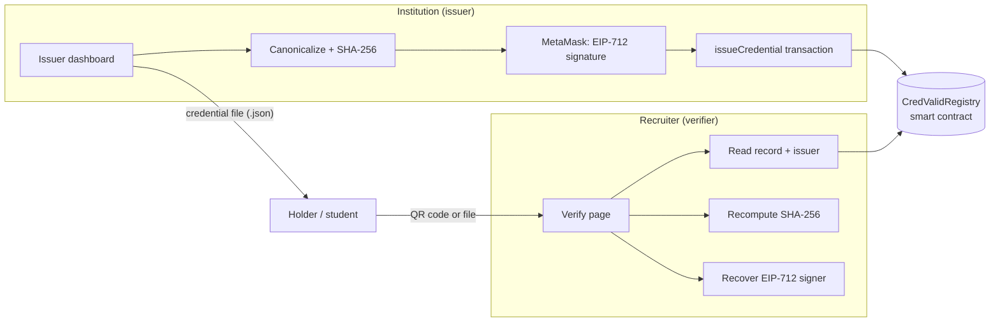

# CredValid

Universities and employers sign credentials with a registered key and anchor a SHA-256 commitment on an EVM chain. Recruiters scan a QR code and check the issuer, the signature, the anchored record, revocation and expiry.

No backend, no database, no auth server: a React app, a Solidity contract, and the user's wallet.

```
credvalid/
├── contracts/   CredValidRegistry.sol, Foundry tests, deploy script
└── web/         React + TypeScript + Vite app (demo mode + testnet mode)
```

## Architecture overview

### Problem statement

- **Credential fraud is common and cheap.** Fake degrees and inflated experience letters are easy to produce with an image editor. Recruiters in India routinely find mismatches during background checks.
- **Manual verification is slow.** Confirming a degree means emailing a university registrar or paying a background-check agency, and waiting days or weeks.
- **Centralized databases are fragile.** A single verification portal can go down, be breached, or disappear when a vendor shuts down, and it holds students' personal data in one place.
- **Paper and PDF certificates can't prove they're unaltered.** A PDF says nothing about whether it was edited after the university issued it.

### What CredValid solves

CredValid lets an approved institution (e.g. Amity University, IIT Delhi, Sharda University) issue a digitally signed credential and record a tamper-proof fingerprint of it on a public blockchain. A recruiter scans a QR code or pastes an ID and, in seconds, learns:

1. whether the credential exists and was issued by an **approved** institution,
2. whether its contents were **changed** after issue,
3. whether it was **signed** by that institution's registered key,
4. whether it has been **revoked, replaced or expired**.

No personal data goes on chain, no central server is needed, and the recruiter needs no account or crypto knowledge.

### Tech stack

| Layer | Technology | Why |
| --- | --- | --- |
| Smart contract | Solidity 0.8.28, OpenZeppelin (`AccessControl`, `EIP712`, `ECDSA`) | Audited building blocks for roles and signature checks |
| Contract tooling | Foundry (forge, anvil) | Fast compile, unit + fuzz tests, local chain |
| Blockchain | Polygon Amoy testnet (EVM) | Low fees, public explorer |
| Frontend | React 19, TypeScript (strict), Vite 8 | Typed, fast single-page app |
| Styling / UI | Tailwind CSS 4, shadcn/ui-style components (Radix UI), Lucide icons | Accessible, consistent design system |
| Data & forms | TanStack Query, React Hook Form, Zod, React Router 7 | Caching, validated forms, routing |
| Web3 client | viem + MetaMask (EIP-1193 wallet) | Typed contract calls, wallet signing |
| Cryptography | SHA-256, EIP-712 typed signatures, Web Crypto random IDs | Fingerprints, issuer endorsement, unguessable IDs |
| QR | `qrcode` (generate), `jsQR` (scan from camera or image) | Opaque verification links |
| Testing | Vitest, Testing Library, Foundry tests, anvil integration script | Unit, UI and on-chain coverage |
| Storage | Browser `localStorage` (demo data, local history only) | No backend or database |

### System architecture



The app is split into clear layers inside `web/src`:

| Layer | Folder | Responsibility |
| --- | --- | --- |
| UI | `pages/`, `components/app`, `components/ui`, `layouts/` | Screens, design system, app shell |
| App state | `app/` | Mode (demo/testnet), wallet, history, React Query |
| Verification engine | `verify/engine.ts` | Runs every check and returns one of 12 result states |
| Crypto | `crypto/` | Canonical payload, SHA-256, EIP-712, IDs, document parsing |
| Registry adapters | `registry/` | Same interface for the on-chain contract and the demo store |
| Demo | `demo/` | Simulated registry and fictional sample data |
| Wallet | `wallet/` | MetaMask connection and network switching |

Because demo and testnet modes share one `RegistryService` interface, every screen works identically in both; only the data source changes.

### How issuing works

1. The issuer fills in the recipient's name, credential type, title and dates.
2. The browser builds a **canonical payload** (fixed key order, normalized text) including a random 32-byte salt.
3. It computes `payloadHash = SHA-256(payload)`.
4. The issuer's registered key signs an **EIP-712** message `(credentialId, payloadHash, issuer, expiresAt)`.
5. The issuer sends `issueCredential(...)`. The contract checks the signer is the issuer's registered key before storing anything.
6. The recipient receives a **credential file** (payload + signature) and a **QR code** containing only the random ID.

### How verification works

1. The recruiter scans the QR or enters the ID; optionally uploads the holder's credential file.
2. The app reads the on-chain record and the issuer's approval status.
3. It recomputes the SHA-256 of the file and compares it with the recorded fingerprint.
4. It recovers the EIP-712 signer and compares it with the key recorded at issuance.
5. It checks revocation, supersession and expiry.
6. It shows a plain-English result: Verified, Data mismatch, Invalid signature, Untrusted issuer, Revoked, Expired, Replaced, Not found, or Network unavailable (a network error is never reported as fraud).

### Smart contract design

`CredValidRegistry` stores per credential: payload hash, issuer, signer, issue time, expiry, status, revocation reason and replacement ID.

- **Roles:** admins (`ISSUER_ADMIN_ROLE`) approve, suspend or reinstate institutions and bind each to one signing key.
- **Issue:** only active issuers, and only with a valid signature from their registered key. Duplicate IDs are rejected.
- **Revoke:** the credential's issuer or an admin.
- **Supersede:** the original issuer replaces a credential with a corrected one in a single transaction.
- **Events** for every change, so the dashboard can list credentials and issuers without a backend.

### Data privacy

| On the blockchain (public) | In the holder's credential file (private) |
| --- | --- |
| Random credential ID | Name and optional email |
| SHA-256 fingerprint | Degree or job title |
| Issuer account and signing key | Issue and expiry dates |
| Timestamps, status, revocation reason code | Salt and issuer signature |

The random salt stops anyone from guessing names and matching them against the public fingerprints.

### Modes, testing and limitations

- **Demo mode** works instantly: hashes and signatures are real, the registry is simulated in the browser, and every result is labelled "Simulated". **Testnet mode** uses the deployed contract on Polygon Amoy with MetaMask.
- **Testing:** 29 Foundry contract tests (including fuzzing and a frontend/contract signature parity check), 45 frontend unit and UI tests, and an 18-step integration run against a local anvil chain.
- **Limitations:** a verifier needs the holder's file to confirm the details (the chain holds only a fingerprint); trust depends on admins approving genuine institutions; lost or stolen issuer keys need an admin to rotate them.
- **Future scope:** mainnet/L2 deployment, multisig governance for admins, an indexer for large registries, DigiLocker/email delivery of credential files, and selective disclosure (sharing only some fields).

## Quick start (demo mode — nothing to configure)

```bash
cd web
npm install
npm run dev          # http://localhost:5173
```

Demo mode works with no wallet, RPC or contract. Open **/verify** and try the 17 seeded credentials (genuine, tampered, forged, false-issuer, revoked, expired, superseded, unknown), or open **/app** to issue, revoke and supersede.

## What's real in each mode

|                         | Demo mode                                   | Testnet mode                                  |
| ----------------------- | ------------------------------------------- | --------------------------------------------- |
| Canonical payload       | Real                                        | Real                                          |
| SHA-256 commitment      | Real                                        | Real                                          |
| EIP-712 signature       | Real (in-memory key per session)            | Real (your wallet)                            |
| Registry                | Simulated in `localStorage`                 | Deployed `CredValidRegistry`                  |
| Transactions            | Timers. No hash, nothing broadcast          | Wallet-signed, mined, with explorer links     |
| Labels                  | Every result and metric tagged **Simulated** | Tagged **On-chain**                          |

Demo files are signed against an EIP-712 domain bound to the zero address, so a demo credential can never pass against a real registry — it comes back `WRONG_NETWORK`.

## Tests

```bash
# Contract (29 tests incl. fuzzing and a frontend/contract EIP-712 parity vector)
cd contracts && npm install && npm test       # or plain `forge test` with Foundry installed

# Frontend unit + UI workflow tests (45)
cd web && npm test

# Testnet-mode code against a real local chain (anvil): deploy, register, sign,
# issue, scan events, verify, tamper, supersede, revoke, wrong network,
# wallet rejection, suspended issuer, RPC outage (18 checks)
cd contracts && npm run build && cd ../web && npm run test:chain

npm run typecheck && npm run build
```

`contracts/package.json` installs Foundry's official npm builds (`@foundry-rs/forge`, `anvil`), so a global Foundry install is optional.

## Deploying to Polygon Amoy

1. **Get test POL** for a deployer account from a faucet (e.g. the Polygon faucet).
2. **Keep the key out of files.** Import it into Foundry's encrypted keystore:
   ```bash
   cast wallet import credvalid-deployer --interactive
   ```
3. **Configure** `contracts/.env` from `.env.example` (RPC URL, optional Polygonscan key, optional first issuer). It's git-ignored and holds no secrets.
4. **Deploy:**
   ```bash
   cd contracts
   source .env
   npx forge script script/Deploy.s.sol --rpc-url amoy --account credvalid-deployer --broadcast
   # optional verification on Polygonscan:
   forge verify-contract <ADDRESS> src/CredValidRegistry.sol:CredValidRegistry \
     --chain 80002 --constructor-args $(cast abi-encode "constructor(address)" <ADMIN>)
   ```
   The script prints the contract address and the deployment block.
5. **Point the app at it.** Copy `web/.env.example` to `web/.env.local`:
   ```bash
   VITE_CHAIN_ID=80002
   VITE_CONTRACT_ADDRESS=0x…        # from step 4
   VITE_DEPLOY_BLOCK=…              # from step 4
   ```
   Restart `npm run dev`, switch to **Testnet** in the app, and connect MetaMask.
6. **Register issuers** from **/app/issuers** with the admin wallet. If an issuer signs with a separate key, connect both accounts in MetaMask when issuing: the signer account signs, the issuer account sends the transaction.

If the ABI changes, run `forge build` then `npm run abi` in `web/` — the frontend never hand-writes it.

Until a contract address is configured, testnet mode shows a "not configured" panel with these steps and the app stays fully usable in demo mode. No contract address, transaction hash or explorer link in this repo is invented.

## Trust model

- **Registry admins** (`ISSUER_ADMIN_ROLE`) approve an institution's account and bind it to one signing address — the wallet itself or a separate key. `DEFAULT_ADMIN_ROLE` can delegate issuer administration. You are trusting admins to approve real institutions.
- **Issuance.** An active issuer calls `issueCredential(id, payloadHash, expiresAt, signature)`. The contract recomputes the EIP-712 digest over `(credentialId, payloadHash, issuer, expiresAt)` and rejects the call unless the signature recovers to that issuer's registered signer. A record existing on chain therefore proves the registered key endorsed exactly those values.
- **Signer rotation** (`setIssuerSigner`) doesn't break old credentials: each record stores the signer accepted at issuance, and verifiers check against that.
- **Revocation** — the credential's issuer (even while suspended) or any issuer admin. Reason codes only, no free text.
- **Supersession** — only the original issuer, while active, because it issues a new signed credential and marks the old one `Superseded → newId` atomically.
- **Suspension** blocks new issuance and supersession. It doesn't void credentials issued while the institution was approved; verifiers see a warning and admins can revoke individually.
- **Duplicates** — credential IDs are unique across all issuers.

### What's on chain

`credentialId` (32 random bytes), `payloadHash`, `issuer`, `signer`, `issuedAt`, `expiresAt`, `status`, `statusChangedAt`, `revocationReason`, `supersededBy`, and each issuer's public institution name. **No candidate names, emails, titles or document contents.** The payload contains a 32-byte random salt so nobody can match a list of names against the public hashes.

## Credential format

**Payload** (`credvalid/1`, off-chain):

```json
{ "v": "credvalid/1", "credentialId": "0x…", "type": "degree",
  "subject": { "name": "Aanya Mehta" }, "title": "MSc Data Science",
  "issuerName": "Northbridge University", "issuerAddress": "0x…",
  "issueDate": "2025-07-18", "expiryDate": null, "salt": "0x…" }
```

**Canonicalization** (`web/src/crypto/canonical.ts`, used by both issuance and verification):

1. Strings: Unicode NFC, trimmed, whitespace runs collapsed to one space.
2. Hex values (ID, salt, address) lower-cased.
3. Dates `YYYY-MM-DD`; no expiry is `null`.
4. Keys sorted, no whitespace, JSON string escaping.
5. `payloadHash = SHA-256(UTF-8 bytes)`.

`expiresAt` on chain is 23:59:59 UTC on the expiry date, or `0`.

**EIP-712:** domain `{ name: "CredValid", version: "1", chainId, verifyingContract }`, type `Credential(bytes32 credentialId,bytes32 payloadHash,address issuer,uint64 expiresAt)`. `contracts/test/DigestParity.t.sol` pins a digest computed by the frontend so the two can't drift.

**Document** — the `.json` file the holder receives: `{ format, mode, chainId, registry, payload, payloadHash, signer, signature }`.

## Verification

The verifier checks, in order, and shows each result:

1. File's chain/registry matches → else `WRONG_NETWORK`
2. Record exists → else `NOT_FOUND` (or `TRANSACTION_PENDING` if this browser has an unconfirmed issuance)
3. Anchoring account is a registered issuer → else `ISSUER_UNAUTHORIZED`
4. Issuer name and account on the file match the registry → else `ISSUER_UNAUTHORIZED` (stops one approved issuer passing itself off as another)
5. SHA-256 of the canonical file equals the commitment → else `HASH_MISMATCH`
6. Signature recovers to the signer recorded at issuance → else `INVALID_SIGNATURE`
7. Not revoked / superseded → `REVOKED` / `SUPERSEDED`
8. Not expired → `EXPIRED`
9. All pass with the holder's file → `VERIFIED`

RPC failures return `UNABLE_TO_VERIFY` with a note that this says nothing about authenticity. A matching hash alone is never reported as verified. Without the holder's file the result is `UNABLE_TO_VERIFY` ("record is active, contents not checked"). `WALLET_NOT_CONNECTED` is shown for issuer/admin actions in testnet mode.

## Limitations

- **The QR alone can't prove contents.** It holds an opaque ID; the chain holds a commitment. The verifier needs the holder's file (or another secure sharing channel) to confirm what the credential says. In testnet mode the app keeps issued files in memory for the session only — issuers must hand the file to the holder.
- **Approval is a human decision.** CredValid proves a registered key signed something. It doesn't prove admins vetted the institution, or that the institution checked source documents. The UI never claims independent verification.
- **The file is personal data.** Whoever has it can read it. Share deliberately, over private channels.
- **Key compromise** lets an attacker sign until an admin rotates the signer; affected credentials need review and revocation.
- **Testnet isn't production.** Amoy can be reset and public RPCs rate-limit. Production needs an audit, a governance plan for the admin role (multisig), and a mainnet/L2 decision. Event scans read from `VITE_DEPLOY_BLOCK`; very large registries should add an indexer.
- **Local history.** Verification history and transaction lists live in the browser's `localStorage`. There is no shared log.

## Security notes

- No private keys, mnemonics or secrets in source, `.env.example`, or `localStorage`. Demo seed signatures were produced by `npm run seed` with throwaway keys that were discarded; demo session keys live in memory only.
- QR codes and URLs carry only the opaque credential ID.
- Uploaded credential files are parsed locally with a strict schema and never sent anywhere.
- Contract: OpenZeppelin `AccessControl`, `EIP712`, `ECDSA.tryRecover`; custom errors; input validation on IDs, hashes, expiry, names and addresses.

## UI

A light, trust-first B2B interface: `#F8FAFC` background, white surfaces, `#101828` text, a single `#315EFB` accent, and semantic green / amber / red reserved for verified, uncertain and confirmed-invalid states. Geist for text, Geist Mono for IDs and hashes, 4px spacing grid, 10–12px radii, 1px borders.

- **Shell** — collapsible sidebar (Workspace / Management / Preferences) with a demo-or-testnet status block; top bar with breadcrumbs, credential search, network pill, wallet button and an account menu (in demo it switches which issuer you act as). Drawer navigation on mobile.
- **Verify** — the centred, single-purpose screen: ID input, QR camera, QR image upload, credential-file upload, sample credentials, four-step progress, then a status panel kept separate from the credential details and a plain-English "What this means".
- **Issue** — recipient details, credential details, then review: what goes on chain, what stays off it, and what the wallet will ask for. Transaction states: awaiting wallet, submitted, confirmed, failed. Demo issuance is labelled simulated throughout.
- **Registry pages** — credentials (search, type/status/date filters, pagination, row actions), credential detail (status checks, history, collapsible technical details), verification history, issuers, candidates, analytics, settings, transactions.

Reusable components live in `web/src/components/app` (shell, primitives, verification, credentials table, charts, wallet/transaction status, revoke dialog) on top of shadcn-style primitives in `web/src/components/ui` (buttons, inputs, dialogs, menus, tabs, tooltips, toasts).

## Scripts

| `web/`               |                                                         |
| -------------------- | ------------------------------------------------------- |
| `npm run dev`        | Dev server                                              |
| `npm run build`      | Typecheck + production build                            |
| `npm test`           | Vitest unit and UI tests                                |
| `npm run test:chain` | Integration run on a local anvil chain                  |
| `npm run seed`       | Regenerate fictional demo data with fresh throwaway keys |
| `npm run abi`        | Copy the ABI from `contracts/out`                        |

Static hosts without SPA rewrites: build with `VITE_ROUTER=hash`. Netlify-style rewrites are included in `public/_redirects`.
# CredValid
